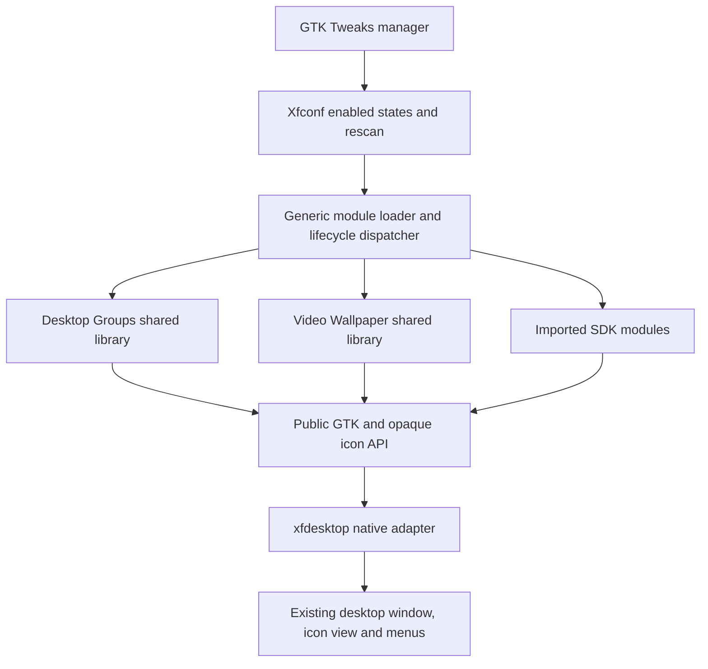

# Architecture and baseline

The project begins with an untouched xfdesktop 4.21.0 source archive, checked against XFCE's official archive. The modular host is built from that upstream source with a focused native extension bridge; it is not a renamed combined fork.

Upstream 4.21.0 already contains an optional built-in video backend. That backend is disabled in this host's build and defaults. The new Video Wallpaper module owns its own GStreamer pipeline, GTK sink, looping, pause/mute state, file chooser and menu. The extension host executable does not link GStreamer or embed the group model/layout implementation.

The one-time host changes expose native icon snapshots, placement and transfer operations, rendering/input hooks, monitor/workspace-aware backdrop requests, menus, and a GTK backdrop layer. The bridge remains the only place aware of `ViewItem`, grid internals and native drag payloads. These private details do not cross the SDK boundary.

GModule loads independently built libraries. Manifest metadata is discovered separately from code loading; modules are queried only when enabled. ABI/size/identity checks precede attaching callbacks. User module directories, development paths and the configured private prefix are scanned in that order. Import notification rescans for new IDs. Existing resident code is not replaced on the fly.

Both initial modules can be disabled and re-enabled in the running host. Group detach removes event handlers, ticks, idles and owned UI, then restores native icon placement without touching files or the persisted membership store. Video detach removes the bus watch, stops its pipeline, removes the backdrop widget and disconnects settings handlers. Dialog lifetimes are explicitly handled to prevent freeing state while a nested GTK loop is using it. Provider capability checks prevent simultaneous competing layout/backdrop providers.

This host is still a modified xfdesktop. A stock distribution build cannot load these modules. Upstream adoption would require agreement on the extension API and lifecycle guarantees. The current ABI is experimental and intentionally focused on the two working features, rather than exposing arbitrary private structures.

The development prefix, host library RPATHs, private D-Bus test sessions and nested preview keep build and preview separate from the active desktop. No session/autostart integration is changed by build or preview. An optional activation helper supports a dedicated systemd user service, with startup verification and backup-based rollback. It is separate from build/preview; other service and session arrangements need their own integration and testing.

## Wayland status

This project build explicitly enables X11 and disables Wayland. The public SDK mostly passes GTK/GDK objects and opaque icon handles, so its module-facing API can remain largely window-system-neutral. The host adapter and desktop surface are platform-specific: the current build relies on xfdesktop's X11 integration and has not been built or verified on a Wayland session.

Upstream Xfce 4.20 describes its Wayland component support as experimental and notes xfdesktop's preliminary support. In 2026, Xfwl4 is being developed as Xfce's Wayland compositor; its 4.21.1 release is explicitly a development release. A future port should first build xfdesktop and this bridge with its Wayland backend, then validate desktop surface/layer placement, icon hit testing and selection, drag-and-drop, workspaces, monitor IDs and scale handling against the compositor. Modules must remain attached to xfdesktop's native desktop surface so they stay below application windows. A separate overlay window is not an appropriate fallback.

The optional External Display Dimming module currently uses XRandR and has no Wayland backend. It would need a compositor-supported color-management/gamma interface or monitor hardware control. Video decode and drawing may be portable through GStreamer/GTK, but per-monitor presentation and stacking still require compositor validation. See the upstream [Xfce 4.20 Wayland status](https://xfce.org/about/tour) and [Xfwl4 4.21.1 development release](https://mail.xfce.org/pipermail/xfce-announce/2026-August/001688.html).

Known gaps: Wayland; signed package distribution; crash isolation; safe replacement of resident module versions without restart; the old video backend's smart window-overlap pause and full style/GL handling; physical monitor/scaling and new-host full login/reboot validation. Module faults remain process faults. Development must use the preview and preserve the host's ownership rules.

The host owns `org.xfce.Tweaks` on its own session bus. The manager watches that name to distinguish a real modular desktop from an older build and to avoid trusting stale Xfconf status values. Unsupported sessions show an explanation and insensitive switches.

Desktop Visibility is an independent presentation module: GTK icon-view visibility changes hide icons, Groups and view-rendered widgets together while preserving the backdrop. Optional per-view interaction hit tests reserve group/widget bounds independently of dispatch order. A generic per-icon alpha hook in the native renderer composites the existing themed icon and label; Groups provides its effective normal/hover opacity through the public opaque-handle helper. The host does not know group membership or store format. ABI 1 structs remain unchanged.
